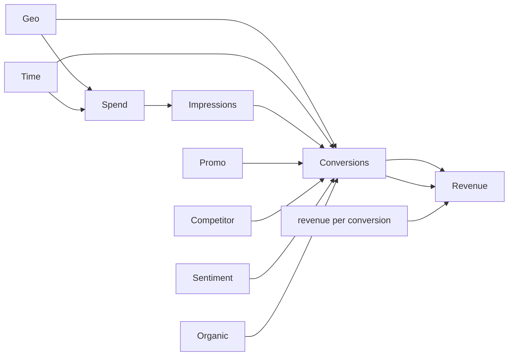

# Causal DAG

Impressions are the exposure and spend is cost; they are not included as separate causal effects. Promotions, organic activity, competitor sales and sentiment are included as pre-treatment controls under this assumption; if any is downstream of paid media it would be a mediator and adjustment would bias the media estimate. Revenue is calculated as conversions × revenue per conversion (RPC is never summed). Geo intercepts and seasonal terms address persistent geographic and calendar differences, but cannot fully remove targeting/reverse-causality confounding.
